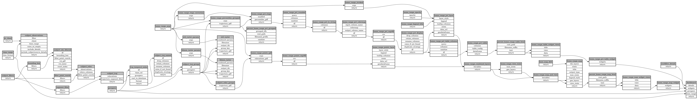

```
# AUTOGENERATED BY ECOSCOPE-WORKFLOWS; see fingerprint in README.md for details

```

```yaml
# fingerprint:
artifacts_sha256_basic: 8ab93d4df4c45c06d1850e582047aebdf0c7c279fd12ef75077bb317c64108e8
artifacts_sha256_strict: 1dd61d7e083349497da85302f608c6a958f120174140e53aa123eb45eef14257
installed_requirements:
- channel: https://repo.prefix.dev/ecoscope-workflows/
  name: ecoscope-platform
  version: {version: ==2.25.3}
- channel: https://repo.prefix.dev/ecoscope-workflows-custom/
  name: ecoscope-workflows-ext-custom
  version: {version: ==0.1.1}
- channel: conda-forge
  name: pydeck
  version: {version: ==0.9.2}
params_sha256: f48419238cd4a249565a9af23863479c84b79a8f692fae967d153c8bde659483
spec_sha256: a3e2cfda0eee4967dbff9d9302fb40b8c13c9f3edba941f28fc3644c6089318e

```

# ecoscope-workflows-home-range-workflow


